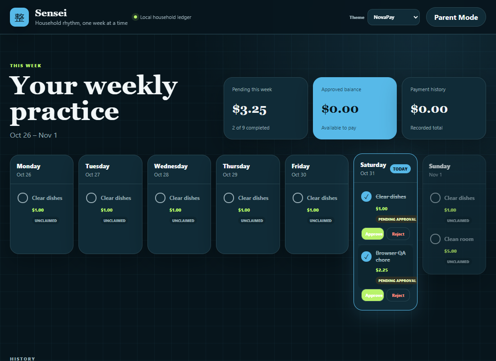
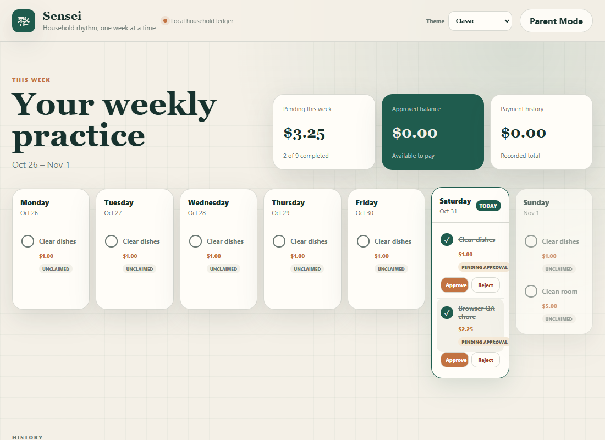
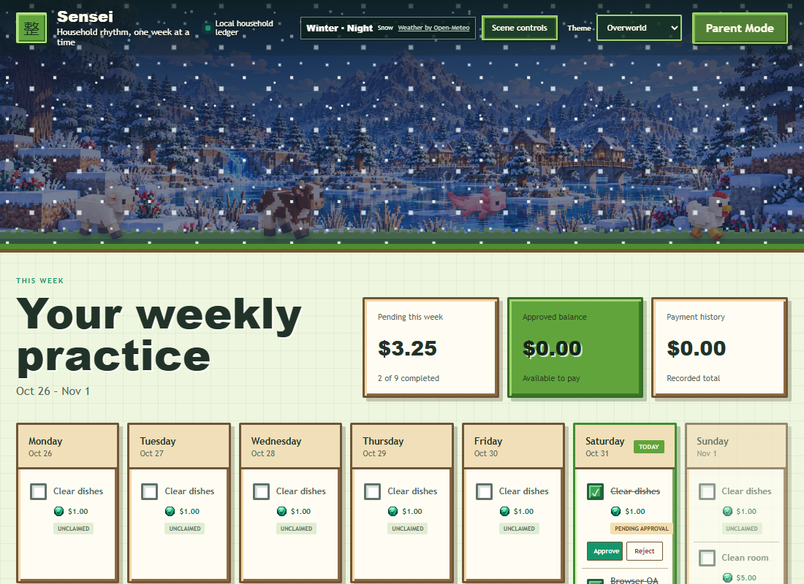

# Sensei

Sensei is a private, locally hosted household chore and allowance tracker for one child and one household. It combines a child-friendly weekly checklist with server-authorized parent approvals, a durable allowance ledger, and three distinct visual themes.

> This repository showcases the working application source and visual system. It does not provide a hosted demo and contains no household database, credentials, or deployment-specific network configuration.



## What it does

- Generates a Monday–Sunday checklist from daily, selected-weekday, weekly, and one-time chores.
- Lets a child claim or undo eligible chores for today and yesterday without an account.
- Opens every chore in a shared detail panel without changing its claim state.
- Lets an authorized parent approve, adjust, or reject one pending claim from its details, with optional decision comments and an explanation required for reductions.
- Preserves historical chore titles, schedules, rewards, decisions, adjustments, and payments.
- Maintains a rolling approved-but-unpaid allowance balance with full or partial payments.
- Summarizes current-month earnings, lifetime earnings, lifetime payments, and available balance from the audited ledger.
- Shows every expected monthly chore alongside approved earnings, pending claims, and missed chores.
- Protects parent actions with Argon2id PIN verification, server-side sessions, throttling, and request validation.
- Runs as one Node process serving the React client, same-origin API, and SQLite database.

## Theme showcase

| NovaPay | Sensei Classic | Overworld Adventure |
| --- | --- | --- |
|  |  |  |

Theme selection is device-local and available in the main header. NovaPay and Classic share the semantic token system; Overworld builds on it with seasonal landscapes, lighting, decorative weather, daytime voxel animals, randomized night encounters, responsive scene composition, and reduced-motion support.

## Stack

- React 19, TypeScript, and Vite 8
- Fastify 5 and same-origin JSON APIs
- SQLite through `better-sqlite3`
- Argon2id parent PIN hashing
- Vitest and Playwright-based browser verification

## Current status

> **Current release:** Living Overworld 1.0 adds layered seasonal scenery, daylight cycles, real-weather atmosphere, compact mobile composition, and a weather-aware creature ecosystem. See the [Living Overworld visual review](docs/LIVING_OVERWORLD_VISUAL_REVIEW.md).

The November 7, 2026 household release extends independent chore review with optional parent comments, per-occurrence final awards, required reduction explanations, quarter-dollar entry validation, child-visible historical details, audited monthly/lifetime Money History totals, original Overworld night encounters, and a full calendar containing newly configured and future expected chores without materializing their weekly snapshots early. The existing bulk review remains a fast standard-reward workflow. Automated coverage includes scheduling, date eligibility, calendar projections, individual and bulk approvals, duplicate prevention, legacy monetary compatibility, payments over LAN HTTP, corrections, sessions, weather fallbacks, themes, responsive layouts, focus restoration, stale-page claim protection, and deterministic encounter selection. The release passes 41 automated tests plus the isolated end-to-end browser workflow.

The application is intentionally small and household-specific: one child, no public internet exposure, no cloud sync, no offline mutation queue, and no generalized account system.

## Development quick start

Requirements: Node.js 24 LTS and pnpm 11.

```powershell
pnpm install
pnpm test
pnpm build
pnpm start
```

The safe defaults bind to `127.0.0.1:3000` and store development data under `.local-data/`. Parent setup happens in the interface on first use. See [development guidance](docs/DEVELOPMENT.md) before configuring LAN access or persistent startup.

## Documentation

- [Living Overworld visual review](docs/LIVING_OVERWORLD_VISUAL_REVIEW.md)
- [Current state](docs/CURRENT_STATE.md)
- [Architecture and data integrity](docs/ARCHITECTURE.md)
- [Theme system and Overworld assets](docs/THEMES.md)
- [Screenshot and artwork showcase](docs/SHOWCASE.md)
- [Development and verification](docs/DEVELOPMENT.md)
- [Planner handoff](docs/PLANNER_HANDOFF.md)
- [Current phase closure](docs/PHASE_CLOSURE.md)

## Privacy, security, and artwork

Runtime databases, backups, logs, `.env` files, local launchers, and generated output are excluded from Git. HTTP transport is an accepted limitation of the private-LAN deployment; it does not encrypt PINs or sessions in transit. Do not expose Sensei directly to the public internet.

The block-world artwork is original Sensei-specific material and is not extracted from Minecraft. Open-Meteo supplies decorative weather data and is attributed in the interface. No general source-code or artwork reuse license is granted by this checkpoint; consult the repository owner before reuse.
