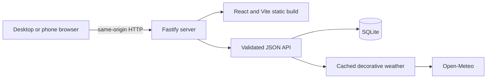

# Architecture

Sensei uses one deliberately small deployment unit: a Node process serves the React build, exposes the Fastify API, and owns the single authoritative SQLite database.

There are no microservices, containers, external identity providers, cloud databases, or offline write queues.

## Source layout

| Path | Responsibility |
| --- | --- |
| `src/client/AppV2.tsx` | Main checklist, Parent Mode, approvals, payments, and application orchestration |
| `src/client/ChoreDetailDialog.tsx` | Shared chore details, PIN continuation, and protected individual-review controls |
| `src/client/CalendarSection.tsx` | Monthly history, day details, weekly bulk-review entry point |
| `src/client/WeekSheet.tsx` | Desktop and mobile chore-first week presentation with independent checkbox/detail targets |
| `src/client/themes.ts` | Theme registry, semantic tokens, device-local persistence |
| `src/client/OverworldScene.tsx` | Seasonal, lighting, weather, animal, and motion composition |
| `src/server/app.ts` | Fastify routes, authorization boundaries, cache policy, validation |
| `src/server/database.ts` | Schema, migrations, default chores, occurrence generation |
| `src/server/chores.ts` | Effective-dated chore configuration |
| `src/server/allowance.ts` | Approval decisions, ledger, payments, adjustments, calendar projections |
| `src/server/auth.ts` | Argon2id credentials, opaque sessions, cookie handling |
| `src/server/overworld.ts` | Fixed-location Open-Meteo mapping, timeout, cache, and fallback |
| `src/shared/types.ts` | Client/server response and domain types |

## Data model

- `chores` identifies a logical chore.
- `chore_revisions` stores effective-dated titles, rewards, schedules, and archive state.
- `weeks` and `chore_occurrences` materialize the applicable revision into immutable historical snapshots.
- `claim_events` records claim and undo actions.
- `weekly_approvals` groups final decisions for presentation and history.
- `approval_lines` gives each occurrence at most one final decision and stores its scheduled reward snapshot, final awarded amount, optional parent comment, and decision source.
- `allowance_transactions` distinguishes earnings, adjustments, and payments; idempotency keys protect repeat submissions.
- `audit_events` records sensitive parent-authorized changes.
- `parent_credentials` and `parent_sessions` store only Argon2id PIN hashes and SHA-256 session-token hashes.

## Main workflows

### Week and occurrence generation

The checklist request derives the Pacific household date and Monday week start, then transactionally creates any missing week and occurrences. Unique `(chore_id, occurrence_date)` constraints make repeated or concurrent generation safe. Recurring revisions take effect on Monday boundaries; one-time chores can be added to the current week.

### Child claims

The browser sends the date represented by its current checklist. The API compares that value with the current server-derived household date before checking the occurrence. This rejects a page left open across midnight. The server then enforces today/yesterday eligibility, future-date rejection, and final-decision locking.

### Parent decisions and bulk approval

Individual approval/rejection operates transactionally and uses the unique occurrence decision constraint. An individual approval may provide a final integer-cent amount; changed amounts must use $0.25 increments, be positive, and include an explanation when below the immutable scheduled snapshot. Optional comments and the final amount are written with the approval line and audit event. Bulk approval submits both the reviewed snapshot IDs and decisions, always uses standard snapshotted rewards, and invalidates stale snapshots. Repeating the same completed request cannot duplicate credit.

The shared chore-detail dialog is presentation only; it does not create a parallel approval service. Pending claims call the existing protected occurrence endpoints. If the device lacks a valid parent session, the dialog uses the existing PIN login route, retains the selected occurrence ID, and reveals the decision controls only after authorization. A completed individual decision refreshes checklist, allowance, calendar, and parent history before restoring focus to the originating row.

Calendar day details and chore details are sequential rather than nested dialogs. Opening a calendar chore closes the day dialog first; closing the chore dialog reopens the same date and restores its row focus. This preserves a single focus trap at a time.

An individually reviewed occurrence gains its unique approval line and no longer appears in `pendingOccurrences`. A weekly review opened before that decision becomes a stale snapshot and receives a conflict response instead of silently processing a changed set.

### Allowance ledger

An approved occurrence creates one earning transaction for its final award. The transaction idempotency key remains occurrence-specific, so retries cannot add a second credit. Payments and later historical adjustments are separate transaction kinds. The balance is derived from transaction effects, never silently overwritten, and corrections cannot create negative debt.

Money History derives lifetime and household-month earnings from finalized approval-line awards plus their audited nominal corrections, grouped by the chore occurrence date. Payments are excluded from earnings and shown separately. Payment/correction request idempotency keys are client-generated; LAN HTTP browsers without `crypto.randomUUID()` use `crypto.getRandomValues()` without changing server validation or accounting semantics.

## Security boundaries

- Every parent endpoint validates a live server session.
- PIN verification and throttling happen on the server.
- PINs use Argon2id; session cookies are opaque, `HttpOnly`, and `SameSite=Strict`.
- Mutation requests require a Sensei header and same-origin checks.
- Host allowlisting rejects unexpected host headers.
- API and HTML responses use `no-store` policies to reduce stale-page reuse.
- Request schemas and domain validation reject malformed fields; monetary values are integer cents with bounds. Newly entered/edited scheduled rewards and changed individual awards use $0.25 increments, while unchanged legacy snapshots are preserved exactly.
- SQLite foreign keys, checks, uniqueness constraints, WAL, synchronous writes, and transactions protect integrity.

HTTP remains unencrypted. These controls do not make public exposure safe; the intended boundary is a private household LAN.

## Time and rollover

All household eligibility uses `America/Los_Angeles`, independent of client clocks. A new Monday appears on the first request; pending decisions from earlier weeks remain reviewable. Seasonal and lighting calculations also use Pacific time, while weather uses a fixed approximate Seattle reference rather than device geolocation.
