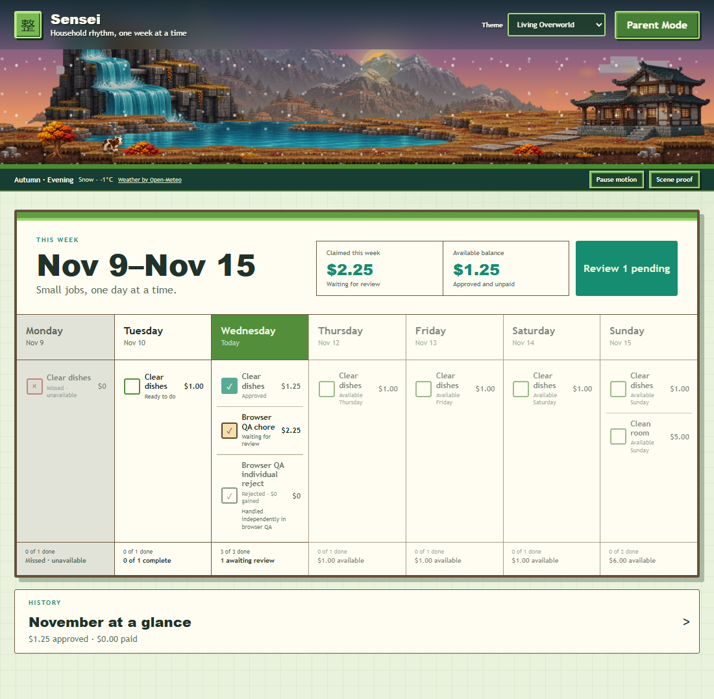
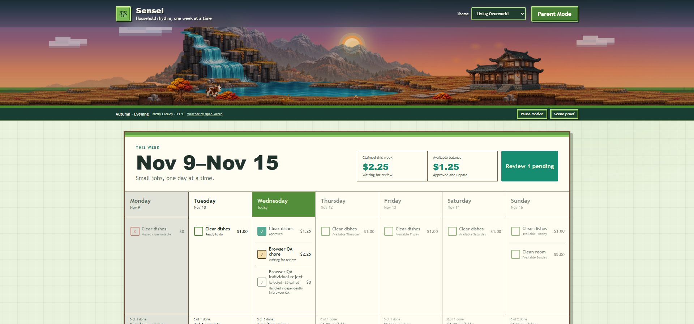
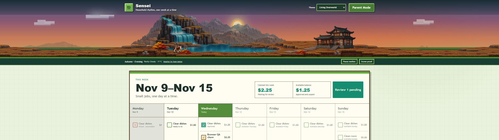

# Living Overworld autumn scene dressing

Checkpoint date: November 11, 2026.

Branch: `feature/living-overworld-autumn-modular`

Baseline: `c1dad32`

## Checkpoint A — mountain and celestial framing

- Shifted the complete central mountain group left.
- Reused two distinct existing distant variants as quiet outer ranges without mirroring them.
- Preserved a natural central saddle for the celestial object.
- Corrected the CSS-generated sun from a square to a circle.
- Kept sun and detailed phased moon near the horizontal center and lowered them below the application header.

## Checkpoint B — waterfall terrain integration

- Reused one scaled outcrop instance as a left connector rather than generating another panorama.
- Mirrored only the connector geometry so its elevation descends toward the outer left meadow.
- Used the existing meadow, structural ground, tree, bush, and rock layers to complete the approach.
- Preserved the main waterfall, connected lake, and complete outcrop unchanged.

## Checkpoint C — authored scene dressing

- Expanded the stable object registry from five to nine restrained placements.
- Added approach and ledge rocks, shoreline grass and flowers, path vegetation, and house-side detail.
- Retained stable IDs, normalized coordinates, scale, bottom alignment, interaction anchors, and desktop-only peripheral visibility where needed.
- Kept the central creature corridors, lake habitat, waterfall, house, and path unobstructed.
- Widened only the autumn habitat/object stage on desktop; mobile omits peripheral connector and ledge objects.

## Evidence

| Viewport | Evidence |
| --- | --- |
| Mobile 390px |  |
| Desktop 1100px |  |
| Desktop 1920px |  |
| Ultrawide 2560 × 720 |  |

## Checkpoint D status

Complete and verified:

- TypeScript client and server checks passed.
- Full automated suite passed: 8 files, 53 tests.
- Production build passed.
- Isolated browser smoke passed all 34 reported workflows.
- Browser evidence uses synthetic data and a temporary SQLite database.
- Verified chores, independent and bulk review, allowance, payments, corrections, Parent Mode, theme persistence, weather, celestial behavior, creatures, reduced motion, calendar, asset loading, and console behavior.

## Known visual limitations

- The scaled left connector is deliberately subtle; it improves the waterfall approach without introducing a new hillside asset.
- Peripheral ultrawide meadows remain restrained to avoid repeated decorative patterns.
- Final visual acceptance remains with the Product Owner.

## Next exact step

Review the four evidence images. If accepted, authorize a separate push/merge/release scope. No push, merge, deployment, publication, household-data change, or service restart occurred in this milestone.

No major landmark asset was regenerated. No backend, database, household data, weather service, creature behavior, chore, allowance, authentication, deployment, or service configuration changed.

