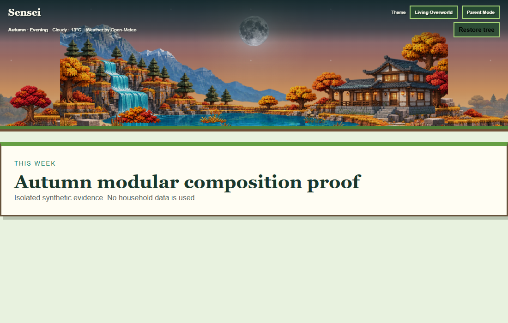

# Living Overworld autumn modular continuation

Checkpoint date: November 11, 2026.

Branch: `feature/living-overworld-autumn-modular`

## Completed

### Checkpoint A — geometry and extraction

- Preserved the existing 2172 × 724 authored core.
- Verified that mountains, connected water, and retreat are already clean transparent structural layers.
- Preserved the combined autumn terrain rather than degrading its overlapping cliffs, rooted trees, shoreline, path, rocks, and ground.
- Recorded canonical coordinates, landmark bounds, extension seams, responsive frames, layer order, and initial habitat metadata in `world.json`.

### Checkpoint B — autumn terrain proof

- Created transparent left and right autumn terrain connectors.
- Created two alternating distant mountain/forest extension variants.
- Composed the assets around the unchanged authored core without stretching landmarks.
- Kept the lake central and the waterfall connected.
- Kept the house on the right with its roof near the vertical midpoint.
- Restored visible sky and centered celestial placement.
- Kept weather status and motion control inside the transparent header in the proof.

### Checkpoint C — environmental objects

- Created independent amber tree, red tree, bush, grass, flowers, and rock assets with transparent backgrounds.
- Preserved the untouched generated masters alongside cleaned browser assets.
- Added stable IDs, normalized positions, scales, layers, and interaction anchors to `world.json`.
- Placed the objects beneath the authored foreground so they participate in scene depth.
- Demonstrated replacing the amber tree with the red variant without changing terrain or other scene layers.
- Re-ran the 390, 1100, 1920, and 32:9 composition evidence with the object layer enabled.

## Evidence

| Viewport | Evidence |
| --- | --- |
| Mobile 390 px |  |
| Desktop 1100 px |  |
| Desktop 1920 px |  |
| Ultrawide 2560 × 720 |  |
| Independent tree replacement |  |

## Verification

- Every retained and generated landscape asset resolves and is 2172 × 724.
- Generated top-corner alpha is transparent or effectively transparent.
- The proof fills all four evaluated widths without a rectangular core boundary.
- Landmark proportions are stable across desktop widths.
- Mobile omits peripheral extensions and preserves the waterfall, lake, mountains, and retreat.
- Four new proof PNGs total 2.61 MB encoded and approximately 24 MB decoded.
- Six cleaned object PNGs have transparent backgrounds and stable baselines; their source masters remain available for future non-destructive refinement.
- The tree replacement changes only one asset source and leaves the terrain pixels unchanged.
- No runtime code, database, chores, allowance, authentication, weather behavior, or creature behavior changed.

## Known issues

- PNG delivery remains unoptimized; no existing WebP encoder was available.
- The isolated proof uses autumn/evening presentation only.
- Existing creatures still use viewport percentages because runtime integration has not begun.
- The generated objects are production candidates, not yet runtime-integrated or Product Owner accepted.
- The proof must not be interpreted as production integration or visual acceptance.

## Next exact step

Complete Checkpoint D on this branch:

1. Teach the current autumn `LivingOverworldScene` to consume the accepted modular manifest while retaining its authored-core fallback.
2. Keep spring, summer, winter, weather, motion preferences, creatures, chores, and allowance behavior unchanged.
3. Add bounded asset-loading, fallback, responsive, reduced-motion, and existing-theme regression coverage.
4. Capture runtime desktop and mobile evidence before any merge, push, deployment, or release decision.
