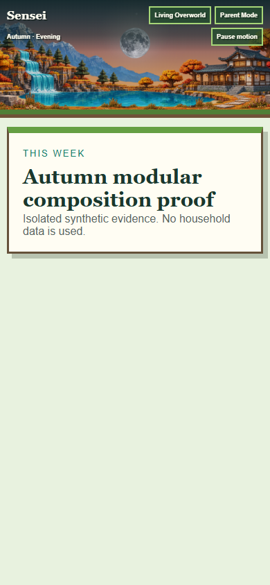
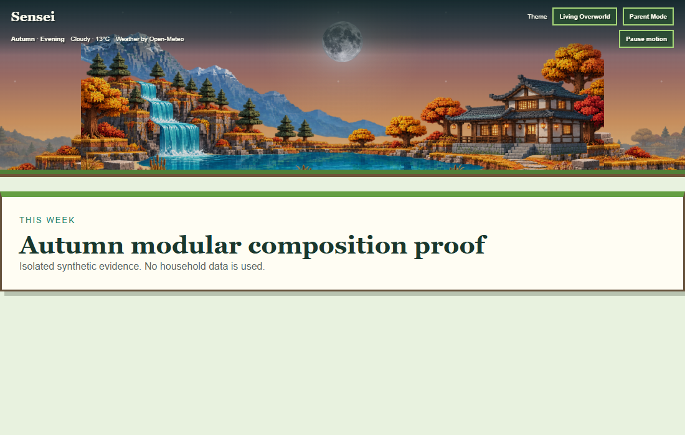
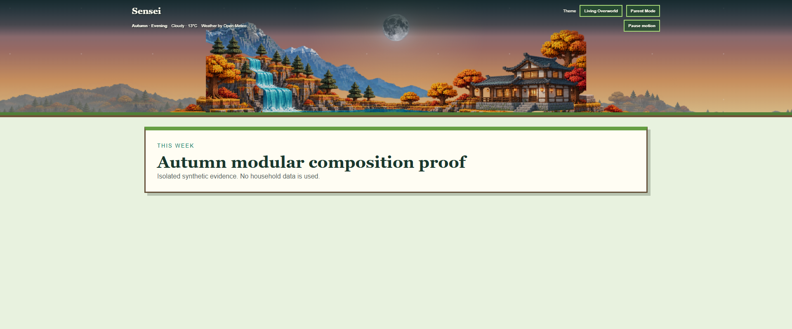
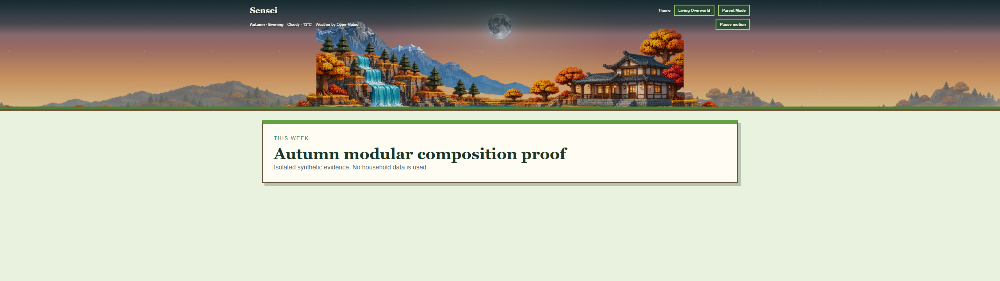

# Living Overworld autumn modular continuation

Checkpoint date: November 11, 2026.

Branch: `feature/living-overworld-autumn-modular`

## Completed

### Checkpoint A — geometry and extraction

- Preserved the existing 2172 × 724 authored core.
- Verified that mountains, connected water, and retreat are already clean transparent structural layers.
- Preserved the combined autumn terrain rather than degrading its overlapping cliffs, rooted trees, shoreline, path, rocks, and ground.
- Recorded canonical coordinates, landmark bounds, extension seams, responsive frames, layer order, and initial habitat metadata in `world.json`.

### Checkpoint B — autumn terrain proof

- Created transparent left and right autumn terrain connectors.
- Created two alternating distant mountain/forest extension variants.
- Composed the assets around the unchanged authored core without stretching landmarks.
- Kept the lake central and the waterfall connected.
- Kept the house on the right with its roof near the vertical midpoint.
- Restored visible sky and centered celestial placement.
- Kept weather status and motion control inside the transparent header in the proof.

## Evidence

| Viewport | Evidence |
| --- | --- |
| Mobile 390 px |  |
| Desktop 1100 px |  |
| Desktop 1920 px |  |
| Ultrawide 2560 × 720 |  |

## Verification

- Every retained and generated landscape asset resolves and is 2172 × 724.
- Generated top-corner alpha is transparent or effectively transparent.
- The proof fills all four evaluated widths without a rectangular core boundary.
- Landmark proportions are stable across desktop widths.
- Mobile omits peripheral extensions and preserves the waterfall, lake, mountains, and retreat.
- Four new proof PNGs total 2.61 MB encoded and approximately 24 MB decoded.
- No runtime code, database, chores, allowance, authentication, weather behavior, or creature behavior changed.

## Known issues

- PNG delivery remains unoptimized; no existing WebP encoder was available.
- The isolated proof uses autumn/evening presentation only.
- Existing creatures still use viewport percentages because runtime integration has not begun.
- Environmental object assets and object replacement proof remain incomplete.
- The proof must not be interpreted as production integration or visual acceptance.

## Next exact step

Complete Checkpoint C:

1. Produce a small transparent autumn object set: tree, bush, grass, flowers, and rock.
2. Assign stable IDs, world positions, scales, interaction anchors, and occlusion layers.
3. Add the objects to the isolated proof.
4. Demonstrate replacing one tree without changing terrain.
5. Recheck all four viewport classes before beginning runtime integration.
