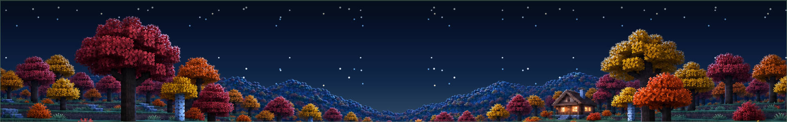

# Living Overworld autumn night proof

Status: **Accepted by the Product Owner and integrated into Living Overworld.**

This proof preserves the accepted autumn geography while testing a dedicated authored night treatment. The desktop and mobile illustrations retain transparent sky openings so the production sun, moon, stars, clouds, and weather can remain independent layers.

The proof changes only landscape lighting and upper silhouette treatment:

- cool moonlit terrain and forest shadows instead of a uniform CSS darkening;
- restrained cool highlights on foliage, mountains, water, and stone;
- modest warm retreat-window light;
- reconstructed transparent skyline edges without a baked sky or blurred transition;
- the same central valley, house side, path, stream, foreground, and responsive framing.

## Review evidence

| Desktop | 390px mobile |
| --- | --- |
|  |  |

- [Full review sheet](assets/living-overworld-night-proof/autumn-night-review-sheet.png)
- [Transparent desktop artwork](assets/living-overworld-night-proof/autumn-night-desktop-proof.png)
- [Transparent mobile artwork](assets/living-overworld-night-proof/autumn-night-mobile-proof.png)

The accepted transparent masters are installed as `seasons/autumn/night-desktop.png` and `seasons/autumn/night-mobile.png`. Living Overworld crossfades the authored treatment over the matching autumn landscape at night while keeping the sky, moon, stars, clouds, fog, and precipitation independent. Spring and summer currently share the autumn fallback and therefore use the same authored night treatment until their own seasonal artwork is approved.
