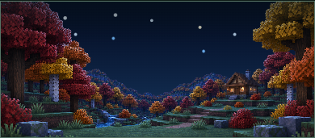

# Living Overworld autumn night proof

Status: **Pending Product Owner visual acceptance. Not integrated into Sensei.**

This proof preserves the accepted autumn geography while testing a dedicated authored night treatment. The desktop and mobile illustrations retain transparent sky openings so the production sun, moon, stars, clouds, and weather can remain independent layers.

The proof changes only landscape lighting and upper silhouette treatment:

- cool moonlit terrain and forest shadows instead of a uniform CSS darkening;
- restrained cool highlights on foliage, mountains, water, and stone;
- modest warm retreat-window light;
- reconstructed transparent skyline edges without a baked sky or blurred transition;
- the same central valley, house side, path, stream, foreground, and responsive framing.

## Review evidence

| Desktop | 390px mobile |
| --- | --- |
|  |  |

- [Full review sheet](assets/living-overworld-night-proof/autumn-night-review-sheet.png)
- [Transparent desktop artwork](assets/living-overworld-night-proof/autumn-night-desktop-proof.png)
- [Transparent mobile artwork](assets/living-overworld-night-proof/autumn-night-mobile-proof.png)

The proof files are documentation artifacts only. Runtime selection, crossfading, production optimization, and replacement of the current autumn artwork require a separate Product Owner acceptance decision.
