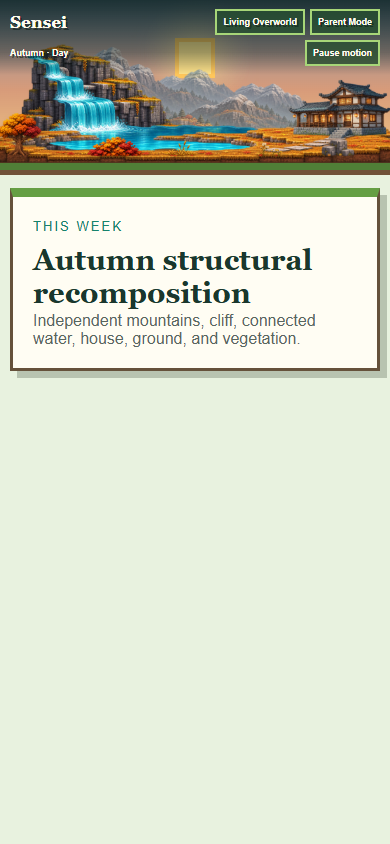
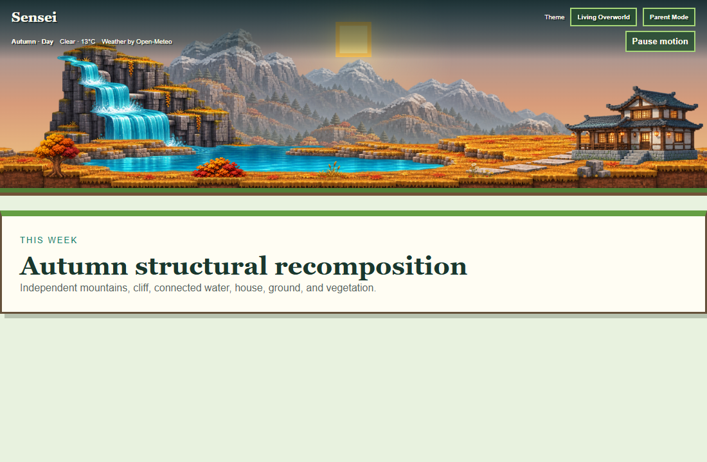
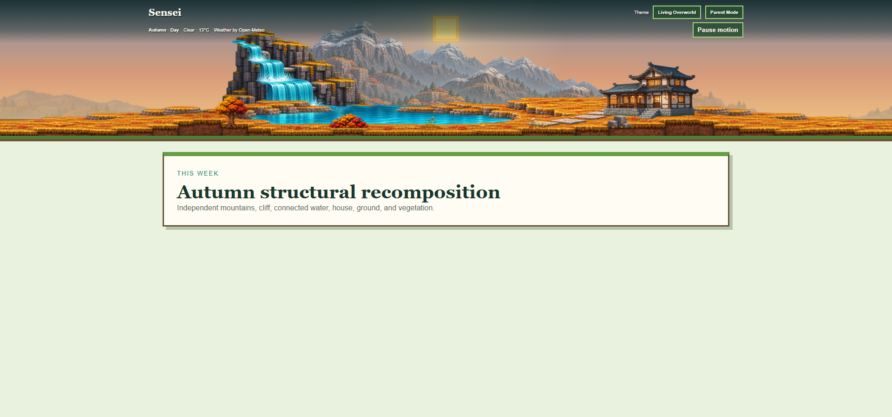
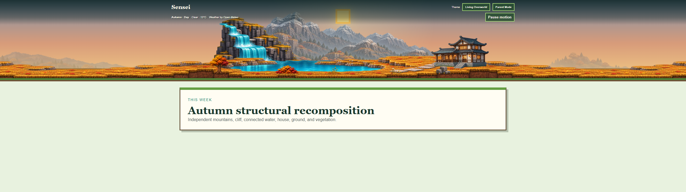
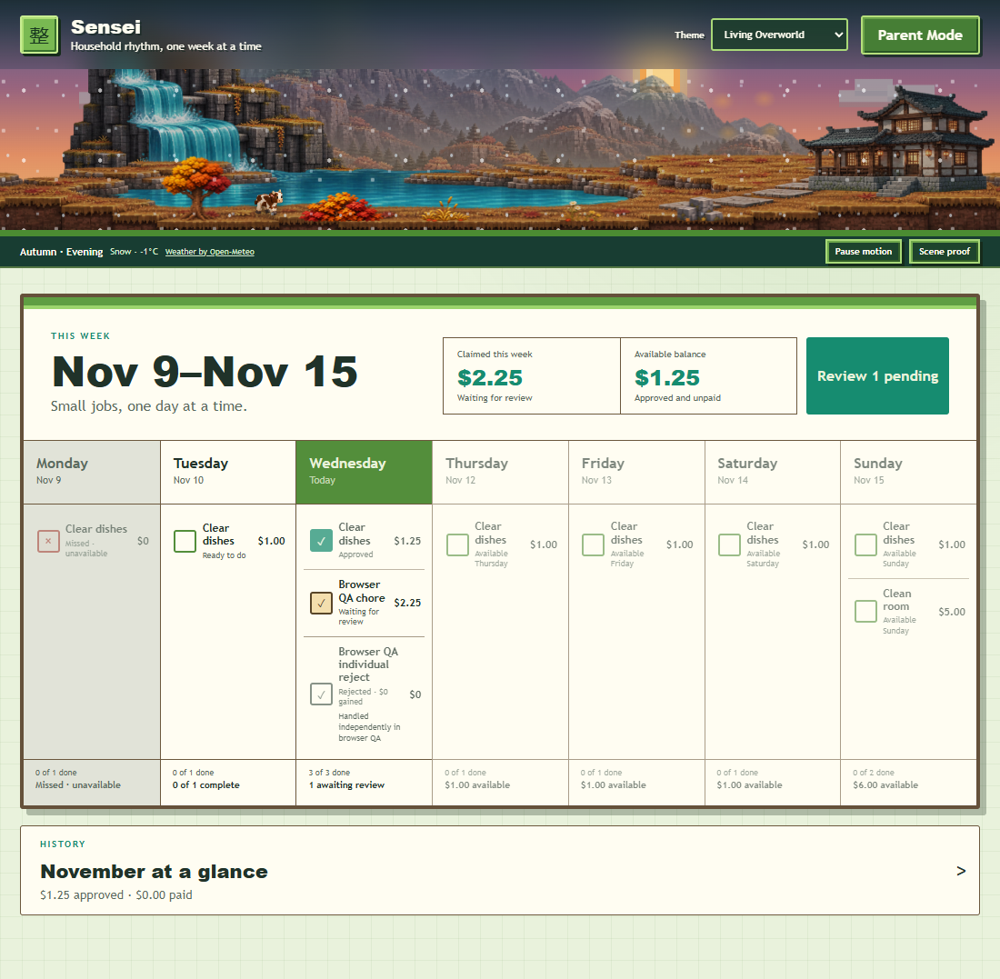

# Living Overworld autumn structural recomposition

Checkpoint date: November 11, 2026.

Branch: `feature/living-overworld-autumn-modular`

Baseline: `8c8492b`

## Completed

### Checkpoint A — structural artwork proof

- Created a complete central mountain group with a natural silhouette.
- Created a complete, tree-free stepped waterfall outcrop.
- Created a separate three-tier waterfall connected to a central lake.
- Created a central structural ground/shoreline with a right-side house foundation.
- Created a quiet meadow extension without baked replaceable objects.
- Reused the complete independent house and the accepted modular vegetation objects.

### Checkpoint B — responsive proof

- Kept the scene at 170px on mobile and 300px on desktop/ultrawide.
- Scaled the house independently; its roof is approximately midway down the scenic viewport and the foundation remains visible.
- Preserved visible sky above the primary mountain peaks and waterfall outcrop.
- Preserved the waterfall-to-lake connection at all evaluated widths.
- Used one world relationship on mobile with tighter horizontal framing.
- Extended desktop and ultrawide terrain without stretching the waterfall, lake, house, or central mountains.

## Evidence

| Viewport | Evidence |
| --- | --- |
| Mobile 390px |  |
| Desktop 1100px |  |
| Desktop 1920px |  |
| Ultrawide 2560 × 720 |  |

## Verified composition findings

- All five new assets are transparent 2172 × 724 PNGs.
- Major structural silhouettes are complete rather than cropped from a panorama.
- No blur or alpha mask hides structural seams.
- The central house, waterfall, lake, and mountain landmarks remain proportionally stable.
- Environmental objects remain independent and anchored to the bounded world stage.
- No application runtime, data, backend, weather, creatures, chores, allowance, or authentication behavior changed in Checkpoints A–B.

## Remaining work

### Checkpoint C — runtime integration

- Replaced only the autumn runtime structure with the complete mountain, cliff, connected water, ground, meadow, and independent house layers.
- Removed the old baked autumn terrain from seasonal rendering rather than hiding it beneath the new scene.
- Preserved spring, summer, and winter assets and seasonal-crossfade behavior.
- Preserved the existing object registry, habitat stage, creatures, weather, celestial system, motion preference, and loading fallback.
- Increased only the autumn scenic viewport to 170px mobile and 260–300px desktop.

### Checkpoint D — verification and evidence

| Runtime view | Evidence |
| --- | --- |
| Desktop application |  |
| Mobile application |  |

- TypeScript checks passed.
- Full automated suite passed: 8 files, 53 tests.
- Production build passed.
- Isolated browser smoke passed all 34 reported workflows, including chores, approval, allowance, payment, corrections, authentication, themes, weather, Living Overworld layering, celestial behavior, creatures, reduced motion, calendar, assets, and console checks.
- Browser checks use synthetic data and a temporary SQLite database.
- No household deployment, production database, service, network, or startup configuration changed.

## Remaining limitations

- The new structural artwork is autumn-only by authorization.
- Outer meadow extensions intentionally remain quiet; future accepted environmental-object work can populate them without repainting terrain.
- Final visual acceptance belongs to the Product Owner.

## Next exact step

Review the two runtime screenshots and the four responsive proofs. If accepted, authorize a separate push/merge/release scope. This branch has not been pushed, merged, deployed, published, or used to restart Sensei.

