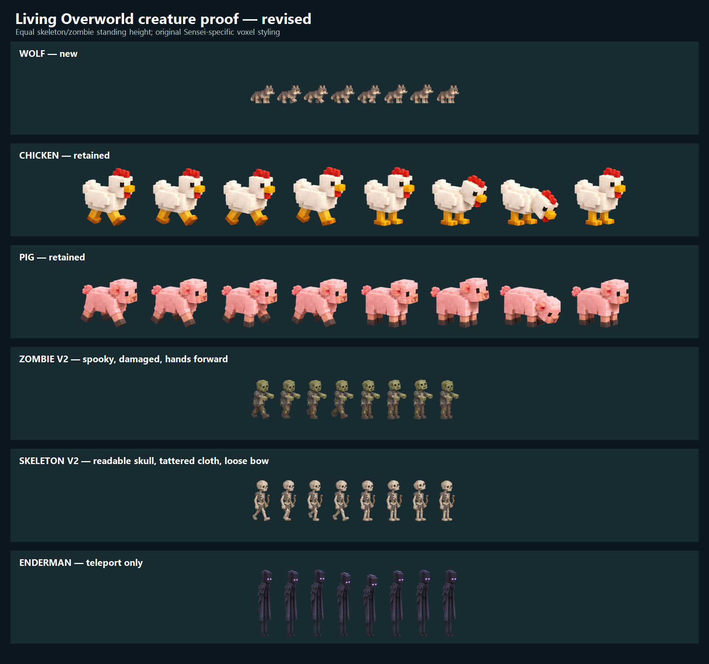
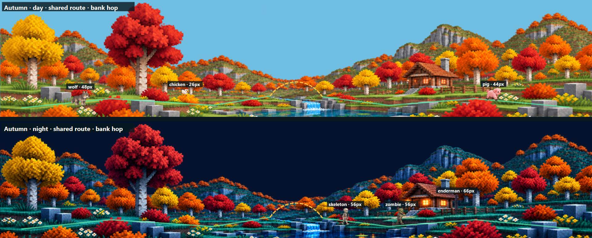
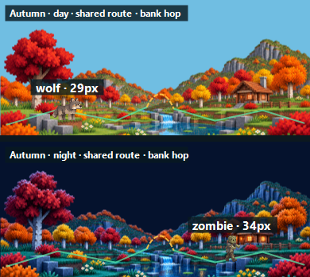
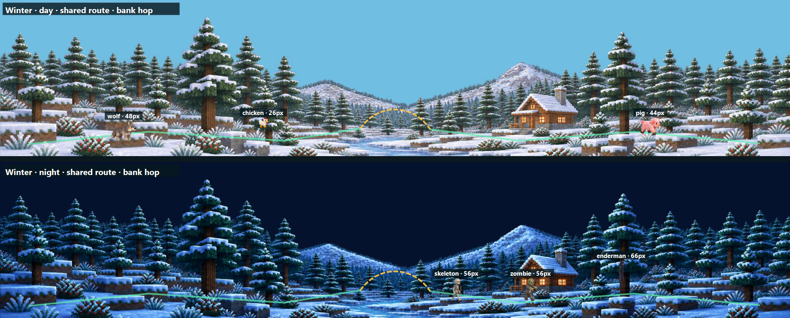
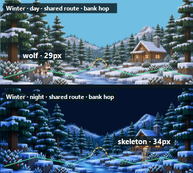
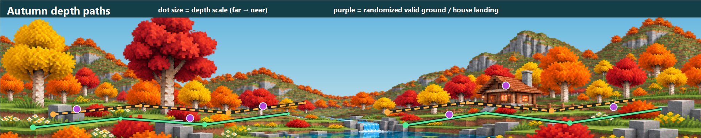
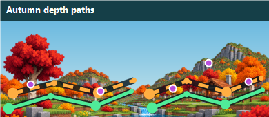
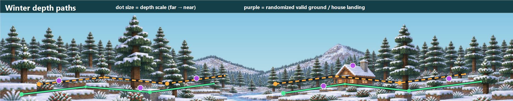
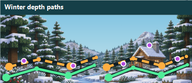

# Living Overworld creature and path proof

Status: **Implemented, verified, published, and deployed**. The accepted artwork and movement rules are active in the Living Overworld household release.

## Character tileset

The proposed roster is deliberately small and original to Sensei's softer, voxel-inspired art direction:

- **Day:** wolf, chicken, and pig. Autumn can use all three. Winter favors the wolf, with chicken or pig appearing only occasionally.
- **Night:** a damaged, hands-forward zombie and a mostly-bone, bow-carrying skeleton slowly wander and pause. They share the same standing height, do not attack, and do not interact with chores.
- **Night rare:** Enderman appears only by teleporting to randomized valid land positions. A house surface is allowed; water is not. Purple arrival/departure particles remain a separate runtime effect rather than baked into the character sheet.
- **Deferred:** chicken jockey and axolotl. The current autumn and winter scenes do not provide a convincing axolotl habitat.

The chicken, pig, and zombie reuse the existing approved visual language. The wolf is new. The skeleton and Enderman are original replacements rather than copies of Minecraft character art.

## Authored paths

Green lines are local daytime wander routes. Orange dashed lines are local nighttime wander routes. Marker size demonstrates character scale: a creature becomes smaller while moving upward/deeper into the illustration and larger while moving downward/forward. Purple points are representative randomized Enderman landing results on valid ground or the house, not fixed anchors. Water is excluded. The annotations will not be visible in Sensei.

The revised direction uses one shared bounded ground network per season rather than separate day and night routes. Movement is bidirectional and locally randomized. A single authored connection between the river banks is marked as a short hop; wolf, chicken, pig, zombie, and skeleton may use it, while Enderman continues to teleport.

## Placement and scale proof

These proofs use the actual 1920 × 380 desktop banner and 390 × 170 portrait-mobile banner. The green line is the shared allowed route and the orange arc is the designated bank hop. Labels show the proposed rendered character height at the illustrated depth.

### Autumn placement

### Winter placement

Proposed near-ground reference heights are 56 px for the equally tall skeleton and zombie, 66 px for Enderman, 48 px for the wolf, 44 px for the pig, and 26 px for the chicken on desktop. Portrait mobile uses approximately 34 px for a human-sized creature and 29 px for the wolf. The route depth map scales these values down as the character moves deeper into the scene.

### Autumn

### Winter

## Implemented behavior

- Use one authored normalized ground network and a small depth map for each season and responsive composition; do not introduce generalized pathfinding.
- Day and night use the same allowed network. A character selects a nearby destination in either direction, reverses or pauses naturally, and is not forced to cross the entire scene from left to right.
- Uniform scale interpolates from the ground network's depth value, making upward travel recede and downward travel approach.
- One connection is tagged as the river-bank hop. Walkers follow a brief vertical arc over that connection and cannot enter water elsewhere. The initial implementation may reuse a walking frame during the hop rather than requiring another sprite sheet.
- Mobile shows at most one creature at a time.
- Desktop uses a restrained soft population target: normally two or three passive creatures by day, or one or two hostile creatures at night. Rare Enderman appearances replace rather than add to the normal night population.
- Significant rain, snow, or fog reduces the active population. Creatures never affect chores, allowance data, authentication, or weather state.
- Enderman selects among authored dry-ground and house landing points, fades out, emits a short independent purple particle effect, and reappears at the resolved surface and corresponding depth scale. Water is excluded. It never traverses the orange route.
- Animation pauses while the page is hidden. Reduced-motion mode keeps creatures stationary or uses a single non-traveling appearance state.

## Current limitations

- Creatures are decorative and have no user interaction, combat, chore reaction, or allowance behavior.
- The runtime uses authored route points rather than generalized pathfinding or terrain collision.
- Spring and summer continue to share autumn scenery and therefore use the autumn route geometry.
- Chicken jockey and axolotl remain deferred.

## Verification

The bounded implementation passes client/server TypeScript checks, 57 automated tests, the production build, and all 35 isolated browser workflows. Browser coverage verifies local creature assets, desktop population, the one-creature mobile cap, reduced motion, weather thinning, and unchanged chore and allowance workflows. Synthetic data and temporary databases are used.

Application release commit `031978e` is published on `main` and deployed to the household installation. Release verification preserved database integrity and all financial, approval, claim, chore, authentication, network, and startup behavior.

