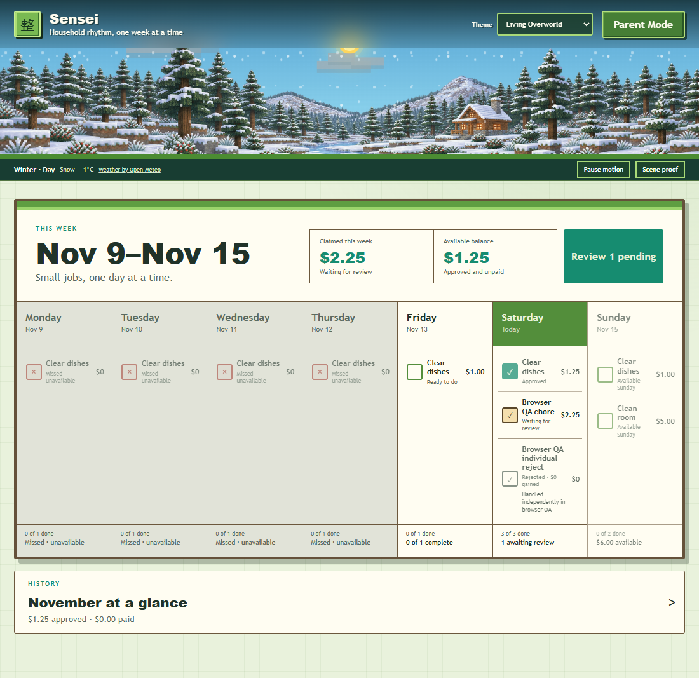
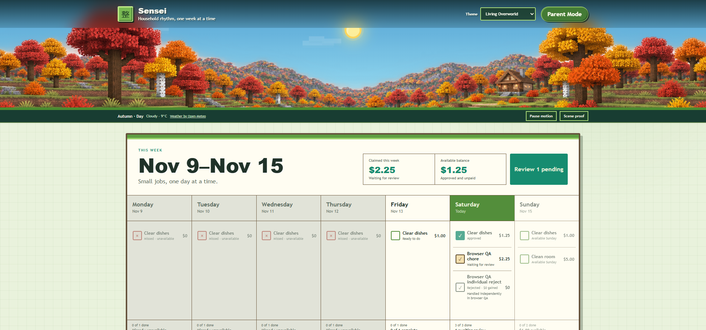
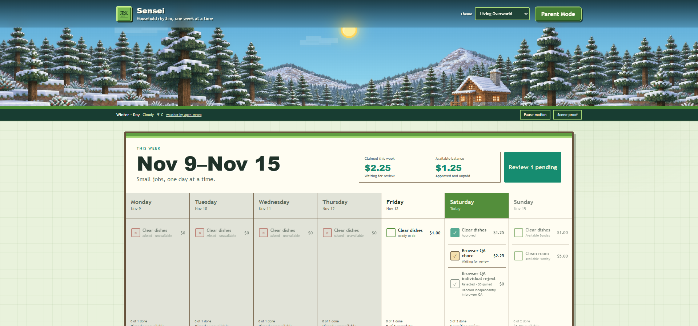
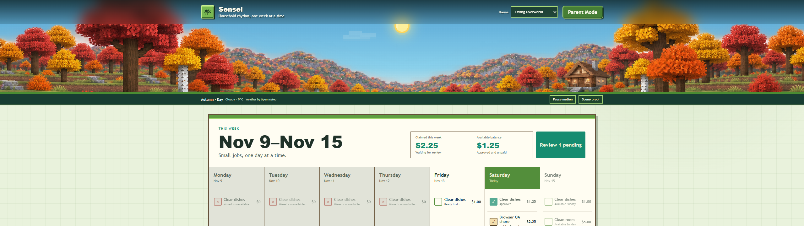
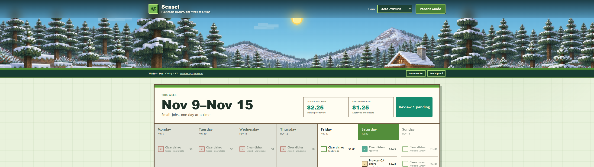

# Living Overworld restart — Product Owner review

Status: **Product Owner accepted release milestone.** Autumn and winter are integrated; weather refinement remains deferred.

## What changed

Living Overworld renders one cohesive seasonal illustration in a shared responsive container. The retired modular renderer, coordinate editor, placement metadata, experimental layouts, lingering capture scripts, and their dedicated tests were removed from the active project. Git history and the preflight stash retain the earlier work for recovery.

Independent layers remain for the sun, detailed phased moon, daylight tint, clouds, rain, snow, and fog. Existing Open-Meteo loading, stale/fallback status, motion preference, reduced-motion handling, and page-visibility suspension remain in place.

## Visual proofs

The autumn and winter images are accepted responsive artwork. Each season has a 1774 × 887 mobile master and a 2172 × 724 desktop crop master. The desktop assets preserve the approved geography while placing the important scenery inside Sensei's shallow banner crop. Spring and summer temporarily fall back to autumn and require separate future artwork authorization.

| Viewport | Autumn | Winter |
| --- | --- | --- |
| 390px mobile |  |  |
| 1100px |  |  |
| 1920px |  |  |
| Ultrawide |  |  |

## Responsive behavior

- The central composition contains the essential retreat, foreground, middle ground, background terrain, and open sky for the 390px mobile view.
- Desktop and ultrawide use a controlled 250–300px banner and reveal the illustrated outer scenery; width does not increase scene height indefinitely.
- Mobile uses a 170px banner and preserves the central core without stretching it.
- The central open sky remains available for the independent sun and moon.
- Functional controls remain below the scenic area.
- No horizontal overflow is permitted.

## Deliberate limitations

- Only autumn and winter proof art exists.
- The generated images are lossless PNGs and need production-format optimization after visual acceptance.
- Desktop uses dedicated zoomed-out crop masters so the shallow 1920px and ultrawide banners retain sky, foreground, and complete focal structures without stretching.
- Creatures and all object-level terrain behavior are absent by design.
- No new stars, shooting stars, comets, accumulation, or environmental simulation was implemented.
- Artwork acceptance and any final-art production remain Product Owner decisions.

## Next milestone

Rain and fog treatment remain intentionally unaccepted. The next bounded milestone should refine weather visuals and mobile particle scale without reopening the seasonal composition or retired modular architecture.
