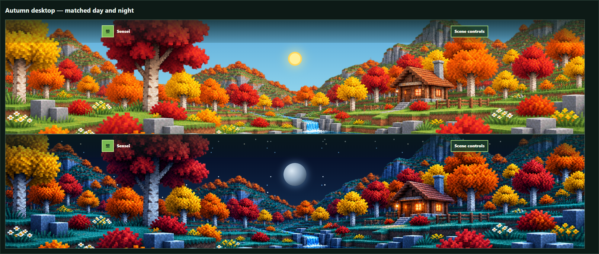
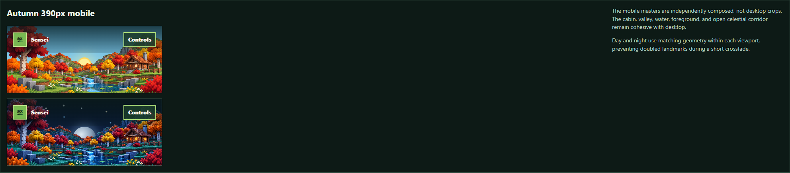
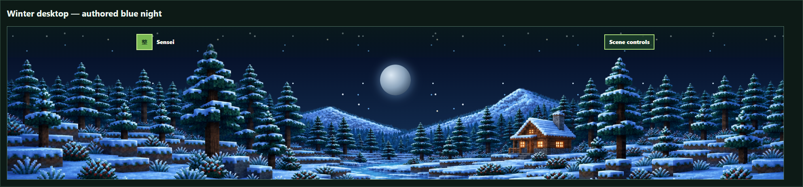
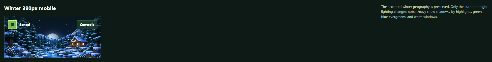

# Living Overworld seasonal redraw proof

Status: **Accepted by the Product Owner and integrated into Living Overworld.**

This proof contains a fresh matched autumn day/night set and dedicated blue winter-night treatments. The autumn mobile and desktop compositions are cohesive rather than identical; each day/night pair preserves its own geometry so lighting can crossfade without doubled landmarks. Winter keeps the accepted daytime geography and changes only the night lighting response.

All six masters have genuine transparent skies and contain no baked celestial objects, stars, clouds, precipitation, fog, creatures, UI, or text. The standalone edge inspection applies no runtime blur, mask, or corrective overlay.

## Review evidence

| Autumn desktop | Autumn mobile |
| --- | --- |
|  |  |

| Winter desktop night | Winter mobile night |
| --- | --- |
|  |  |

- [Standalone skyline inspection](assets/living-overworld-season-redraw-proof/review-edge-inspection.png)
- [Full review page](assets/living-overworld-season-redraw-proof/review-full-page.png)
- [Interactive local review prototype](prototypes/living-overworld-season-redraw-review.html)

The accepted autumn day/night masters replace the previous autumn artwork, and the authored winter-night masters supplement the retained winter day artwork. Runtime celestial, star, cloud, fog, rain, and snow layers remain independent. The release preserves the existing responsive selection, short night crossfade, celestial containment, and application behavior.
