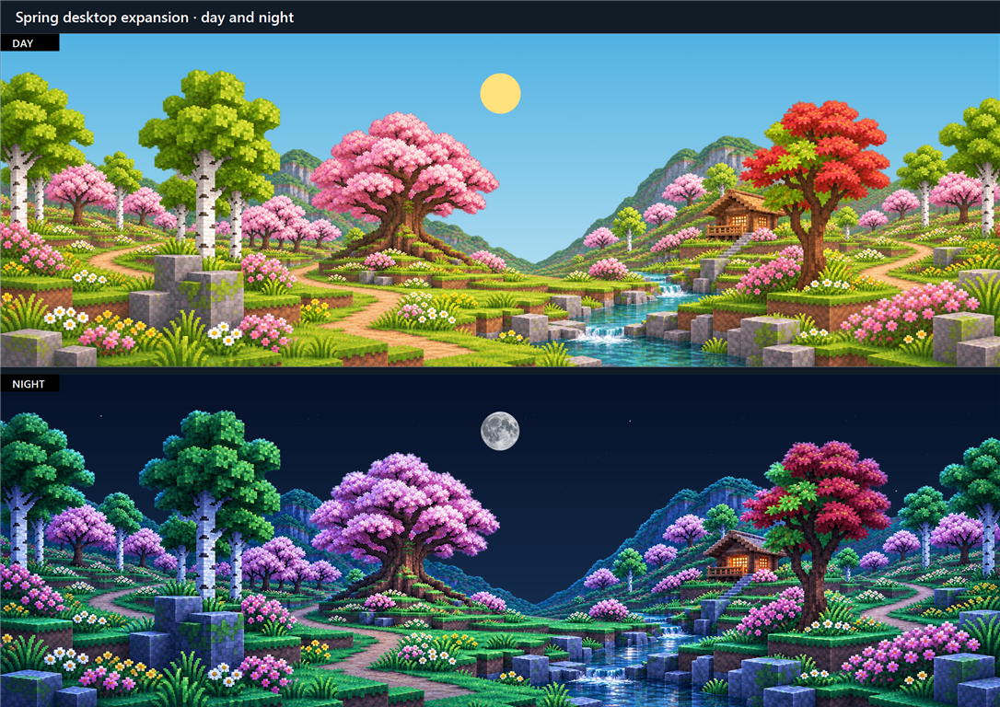
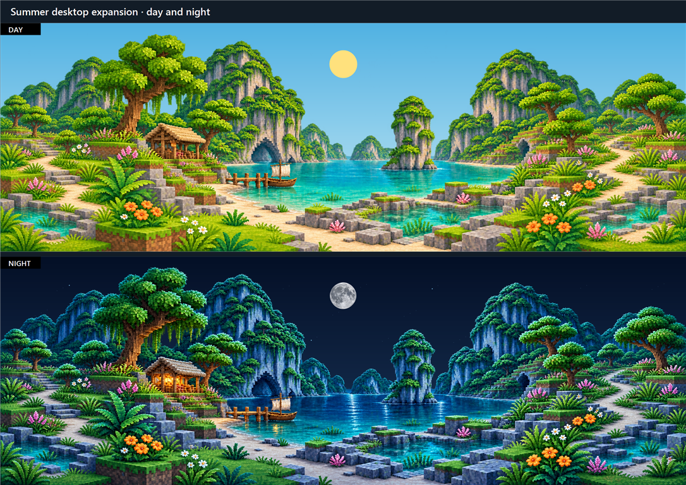

# Living Overworld spring and summer release

Status: **Product Owner approved for publication and household deployment.**

## Implemented artwork

Spring and summer no longer reuse the autumn landscape. Each season has four independent transparent masters:

| Season | Mobile day/night | Desktop day/night |
| --- | --- | --- |
| Spring | 1774 × 887 | 2172 × 724 |
| Summer | 1774 × 887 | 2172 × 724 |

Spring uses a flowering wooded valley with a central sakura tree, stream, paths, and a modest retreat. Summer uses a tropical karst shoreline with open water, connected foreground terrain, tide pools, dock, boat, and shelter. Both follow the established softer illustrative Minecraft-inspired visual language.

The mobile composition is the design core. Desktop artwork expands laterally with additional coherent scenery rather than stretching the portrait-mobile master. Day/night geometry is matched within each responsive composition so the authored night layer can crossfade without doubled landmarks.

## Layering and atmosphere

The seasonal PNGs contain no sky, celestial body, stars, weather, creatures, UI, or text. Their transparent central corridors preserve the shared sky, vertical sun/moon track, lunar phases, cloud density, stars, precipitation, fog, and rare sky events. Landscape features may naturally occlude those shared layers.

Morning and evening continue to use the existing short runtime lighting transitions between authored day and night treatments. Weather behavior is unchanged.

## Review evidence

| Spring desktop | Summer desktop |
| --- | --- |
|  |  |

The proof directory also contains the approved mobile day/night masters, full-resolution transparent desktop masters, and full-resolution review sheets.

## Runtime compatibility

- The seasonal artwork mapping now points spring and summer to their own assets.
- Existing seven-day seasonal blending remains unchanged.
- Mobile and desktop selection still uses the existing semantic `picture` element.
- Summer uses a bounded left-shore and terrace creature route; walkers cannot cross open water to the isolated karst pillars or opposite shore. Its teleport-only Enderman also uses the left-side shelter landing.
- Chores, allowance, Parent Mode, authentication, API contracts, accounting, database schema, weather service, ports, and startup behavior are unchanged.

## Verification

- Client and server TypeScript checks pass.
- All 58 automated tests pass across nine test files.
- The production client and server build passes.
- All 35 isolated browser workflows pass against synthetic data and a temporary SQLite database.
- Desktop checks cover spring and summer at 1100 px and 1920 px; portrait-mobile checks cover both at 390 px.
- Browser verification confirms responsive asset selection, authored night loading, transparent celestial layering, no horizontal overflow, reduced-motion behavior, summer dry-ground creature placement, and unchanged chore, allowance, Parent Mode, payment, correction, and calendar workflows.

## Publication and household deployment

Application commit `ed50de3` is published on `main` and active in the household installation. Release used SQLite's online backup API; the backup and live database both passed `integrity_check`, and all table counts matched before and after restart. Only the established `\Sensei - Household Server` task was restarted. Live desktop and 390 px browser checks loaded all four spring and summer day/night variants at 2172 × 724 and 1774 × 887 respectively, with no console errors or horizontal overflow.

No production data, schema, API, authentication, accounting, network, firewall, port, or startup configuration changed.

## Deferred work

Foreground layers, additional creature interactions, generalized pathfinding, snow accumulation, holiday decoration, and environmental simulation remain outside this release.
