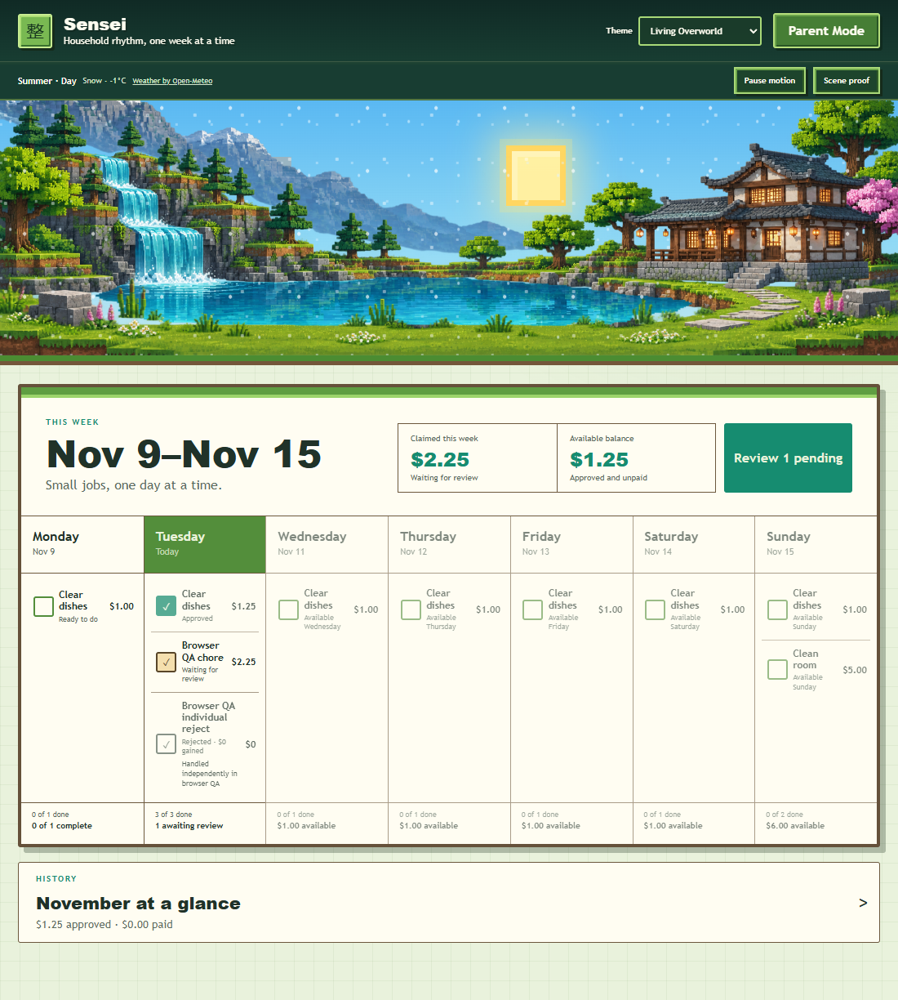
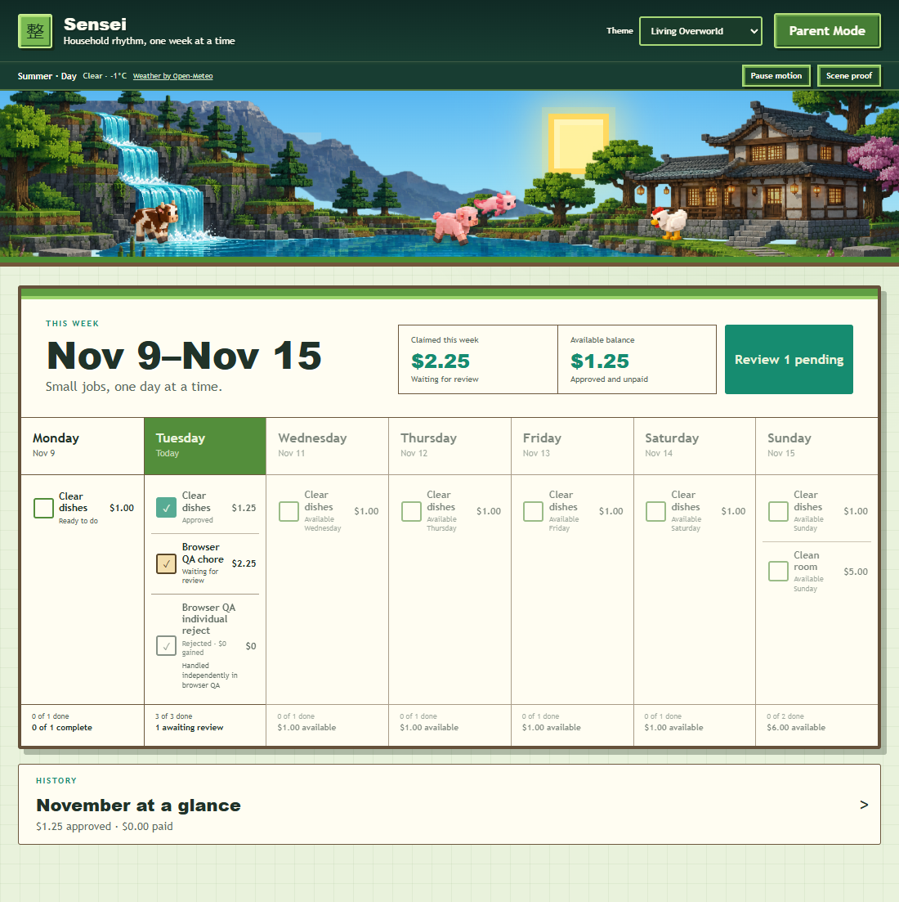
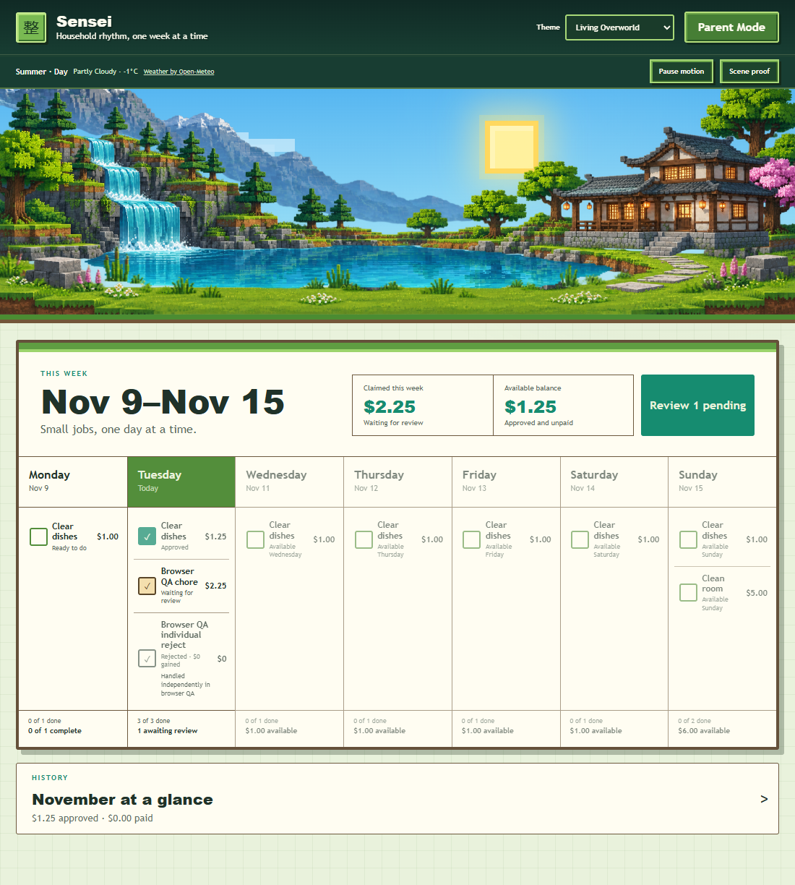
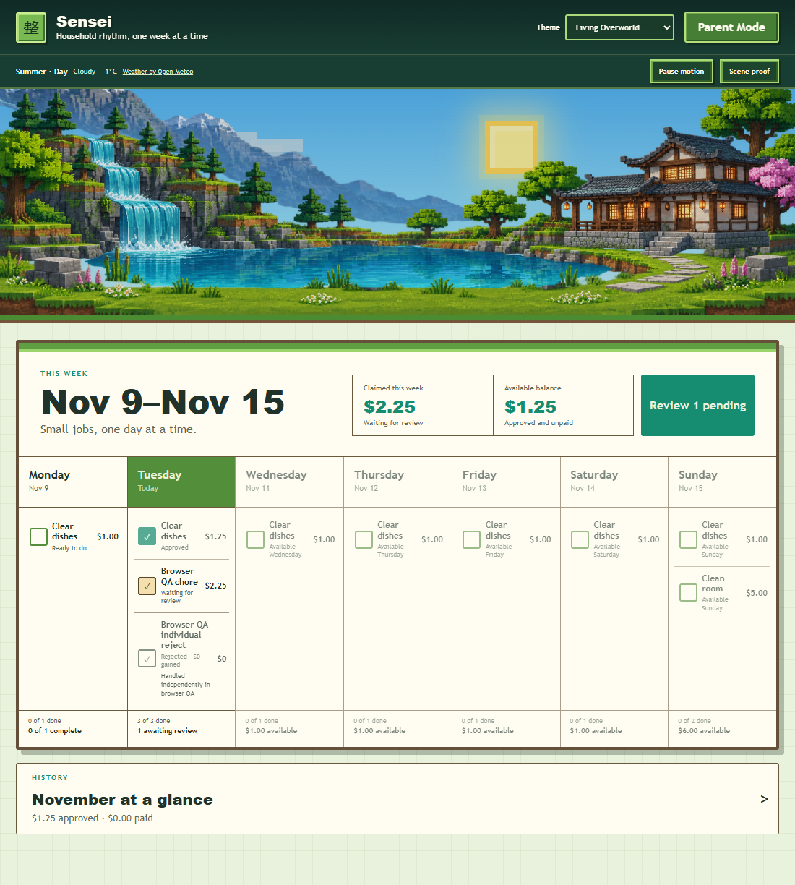
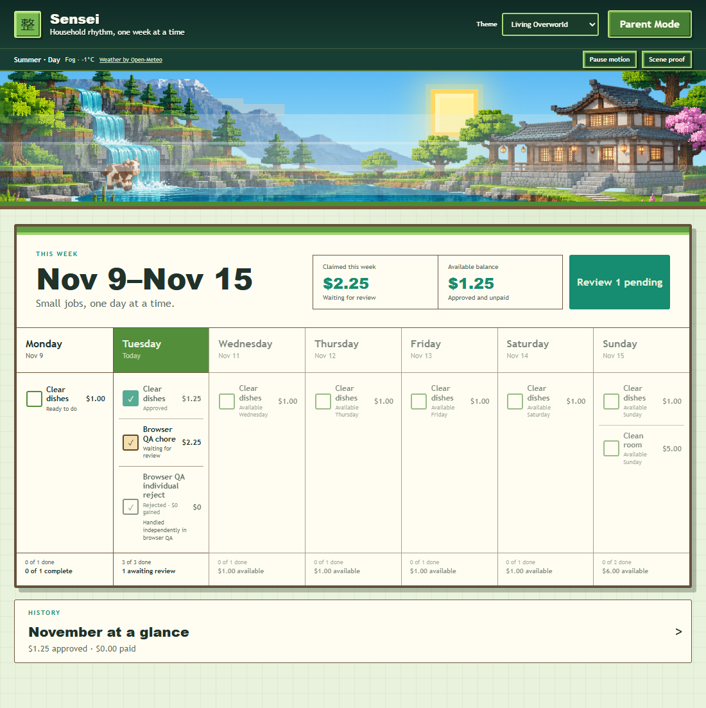
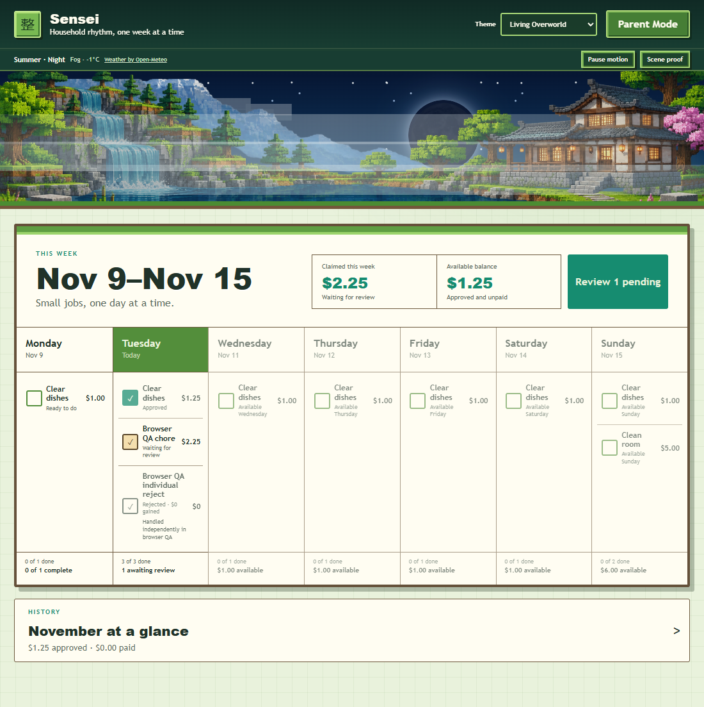
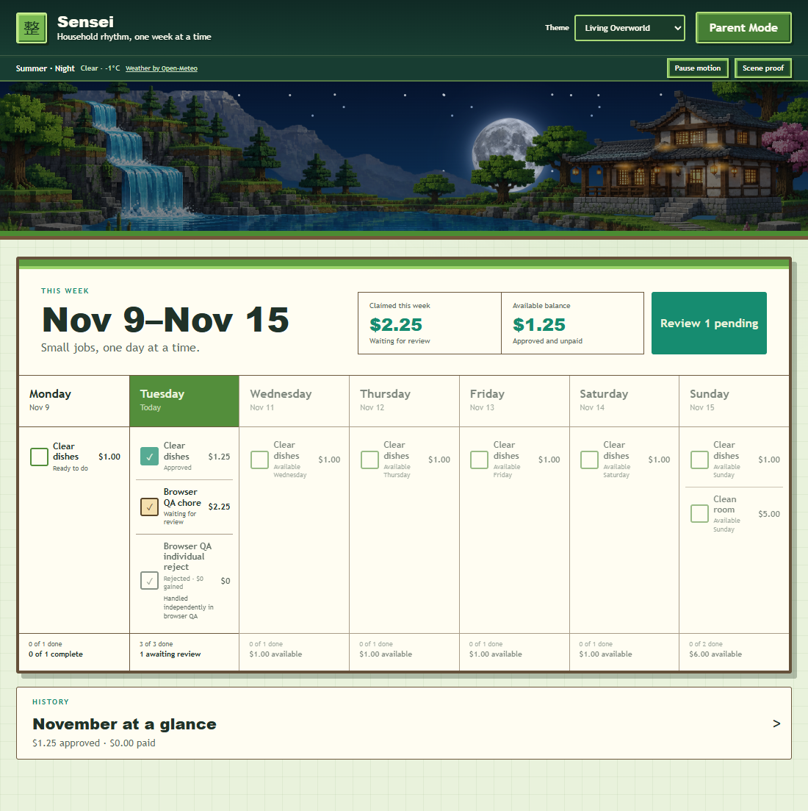

# Living Overworld 1.0 visual review

Review target: `feature/living-overworld-seasons`

Review status: **Gates 1 and 2 implemented; Product Owner authorized release**

Evidence source: isolated browser QA with synthetic household data; no production database was accessed.

This page records the Living Overworld 1.0 landscape, responsive, weather, season, lighting, and creature candidate. Deployment evidence is recorded separately after the controlled household release.

## Seasonal composition and lighting

| Scene | Desktop · 1100 px | Mobile · 390 px / 140 px scene |
| --- | --- | --- |
| Spring · Morning |  |  |
| Summer · Day |  |  |
| Autumn · Evening |  |  |
| Winter · Night |  |  |

The shared fixed camera keeps the mountain and waterfall to the left, the lake through the center, and the retreat in the right third. Mobile uses proportional scaling with a small outer crop; it does not stretch the source layers. Functional controls sit in the header and scene toolbar, outside the 140 px scenic region.

Automatic season selection uses `America/Los_Angeles`. A seven-day boundary window blends only the adjacent season; unchanged layers are reused, and the adjacent image is not mounted outside the transition. Morning, day, evening, and night use the cached Seattle-area sunrise/sunset response with deterministic Pacific-time fallbacks.

## Weather matrix

| Clear | Partly cloudy | Cloudy |
| --- | --- | --- |
|  |  |  |

| Rain | Snow | Fog |
| --- | --- | --- |
|  |  |  |

The theme consumes the existing same-origin Open-Meteo service. It shares the server's 30-minute cache, fixed approximate Seattle reference, request timeout, last-valid fallback, neutral fallback, and provider attribution. A stale or neutral fallback is identified in the scene toolbar. No device location or new permission is used.

### Mobile precipitation scale

| Rain | Snow |
| --- | --- |
|  |  |

Rain and snow particles are reduced in size and density at narrow widths so they remain atmospheric without obscuring the checklist.

### Fog, night contrast, and moon

| Fog · Night | Detailed full moon |
| --- | --- |
|  |  |

The existing detailed round moon and eight deterministic phases remain intact. The scene reserves space for the sun and moon at every responsive size, and the retreat retains readable warm window light at night.

## Gate 1 implementation

- Separate, device-local `Living Overworld` theme; NovaPay, Classic, and the original Overworld remain unchanged.
- Semantic sky, mountain, terrain, water, retreat, vegetation, atmosphere, celestial, precipitation, and foreground layers.
- Four seasonal landscapes, four lighting periods, seven-day adjacent-season transitions, and controlled image mounting.
- Clear, partly cloudy, cloudy, rain, snow, and fog treatments driven by actual weather appearance data.
- 140 px mobile landscape, proportional crop, no horizontal overflow, and controls outside the scene.
- Always-available motion control, `prefers-reduced-motion`, and hidden-page animation suspension.
- Season, weather, light, and moon overrides available only with `?living-preview=1`.
- Decorative elements remain outside keyboard navigation and the accessibility reading order.

## Gate 2 ecosystem

| Desktop | Mobile · 390 px |
| --- | --- |
|  |  |

- Reuses the existing original eight-frame sheep, pig, cow, chicken, and axolotl sprite sheets.
- Shows at most three land animals plus one aquatic axolotl.
- Selects species and population deterministically from the active season, lighting period, and weather appearance.
- Reduces activity during clouds, rain, snow, fog, evening, winter, and night.
- Constrains land animals to three local terrain corridors and the axolotl to the lake.
- Uses CSS sprite stepping and local wandering with pauses; no game engine, pathfinding, or continuous JavaScript animation loop.
- Keeps creatures behind lighting, precipitation, fog, and foreground vegetation.
- Stops movement under the user motion setting, `prefers-reduced-motion`, and hidden-page suspension.

## Known limitations

- Lighting uses four coordinated periods rather than continuous celestial travel.
- The weather cache is in-memory; a process restart without network access falls back to neutral conditions until a valid response is received.
- Snow is atmospheric only. Accumulation, wet-terrain persistence, wind-reactive vegetation, and environmental simulation remain out of scope.
- Existing seasonal raster layers remain the largest theme payload. Gate 1 avoids unnecessary adjacent decoding but does not convert the art library to a new format.
- Creatures use bounded local corridors rather than terrain-aware pathfinding or interactivity.
- Creatures are decorative and do not react to chores.
