# Showcase

Every application screenshot in this gallery was generated by the isolated browser workflow using a temporary SQLite database and synthetic “Browser QA chore” data. The images contain no live household records, names, PINs, tokens, or private network addresses.

## Weekly checklist and individual review

NovaPay presents the current week, pending allowance, and historical calendar in one responsive workspace. The checkbox is reserved for claim and undo; selecting the chore name or remaining row opens shared chore details without changing status. A pending claim can be approved or rejected there after existing parent authorization, without entering weekly Parent Review.

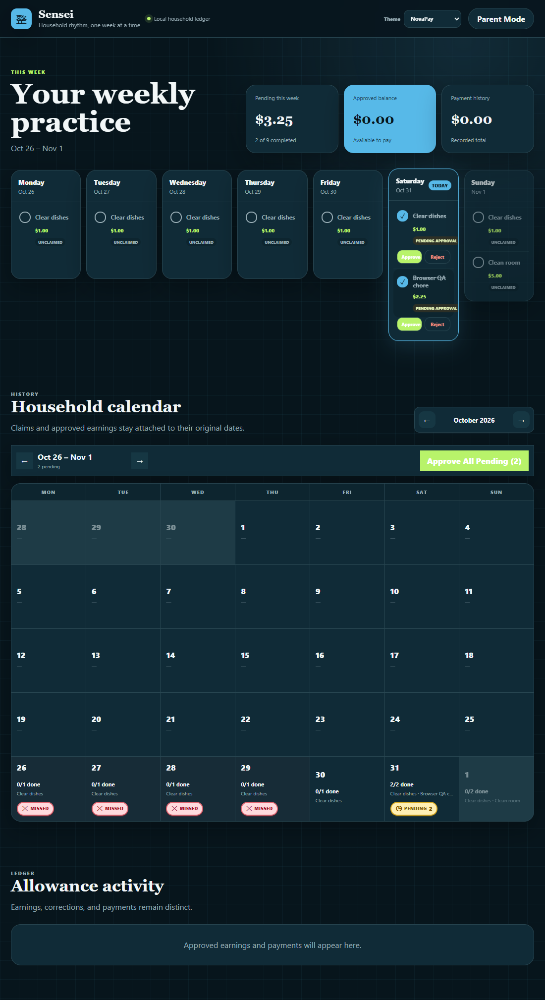

## Itemized bulk approval

The parent sees the exact pending snapshot and gives every pending claim an approve or reject decision. Claims already reviewed through their details are excluded, while a concurrently changed snapshot is rejected rather than silently resubmitted.

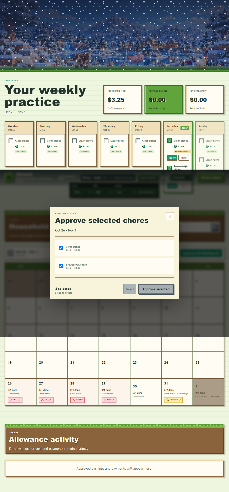

## Calendar outcomes

Calendar cells distinguish approved dollars, pending claims, and locked missed chores while preserving the original occurrence date.

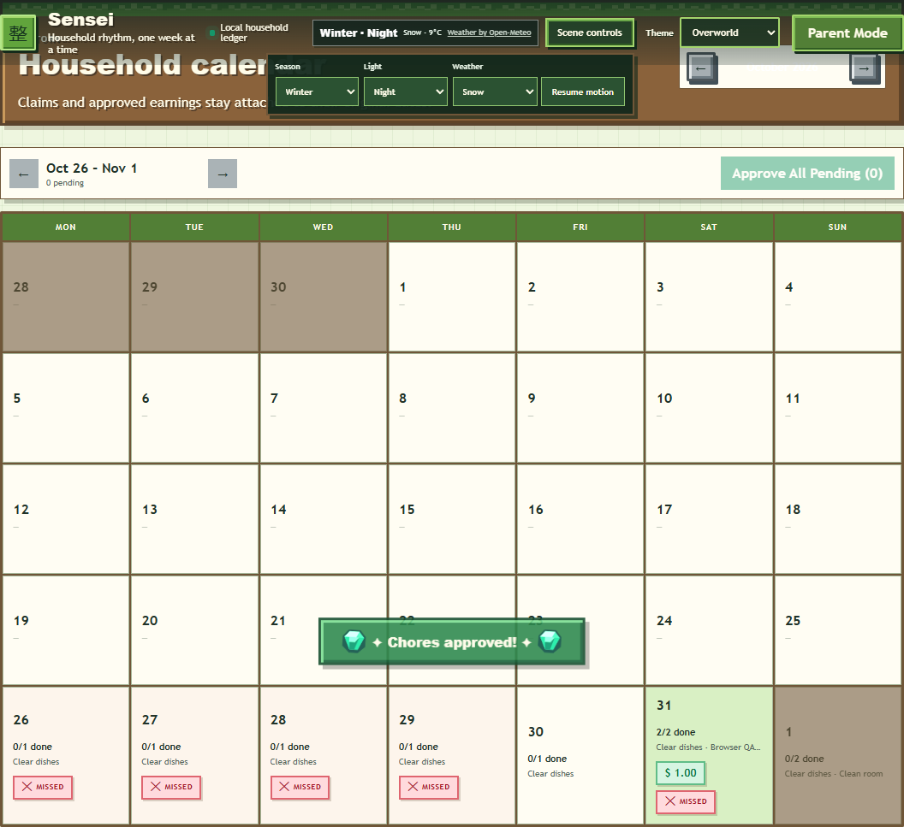

## Allowance and payments

Parent Mode keeps approved history, current historical value, payments, corrections, and export controls separate from the child checklist.

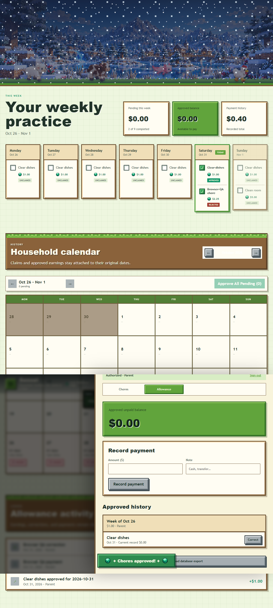

## Theme gallery

### NovaPay

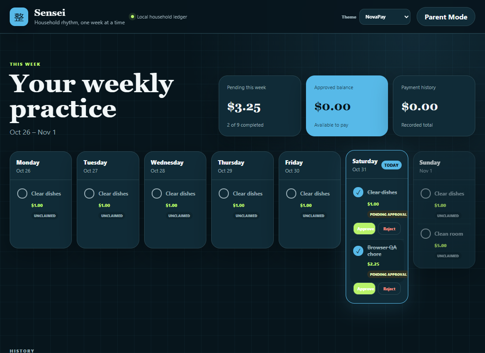

### Sensei Classic

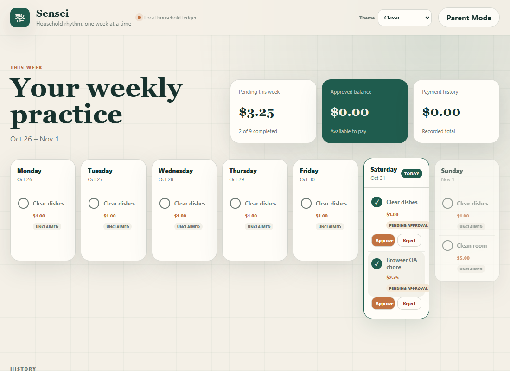

### Overworld Adventure

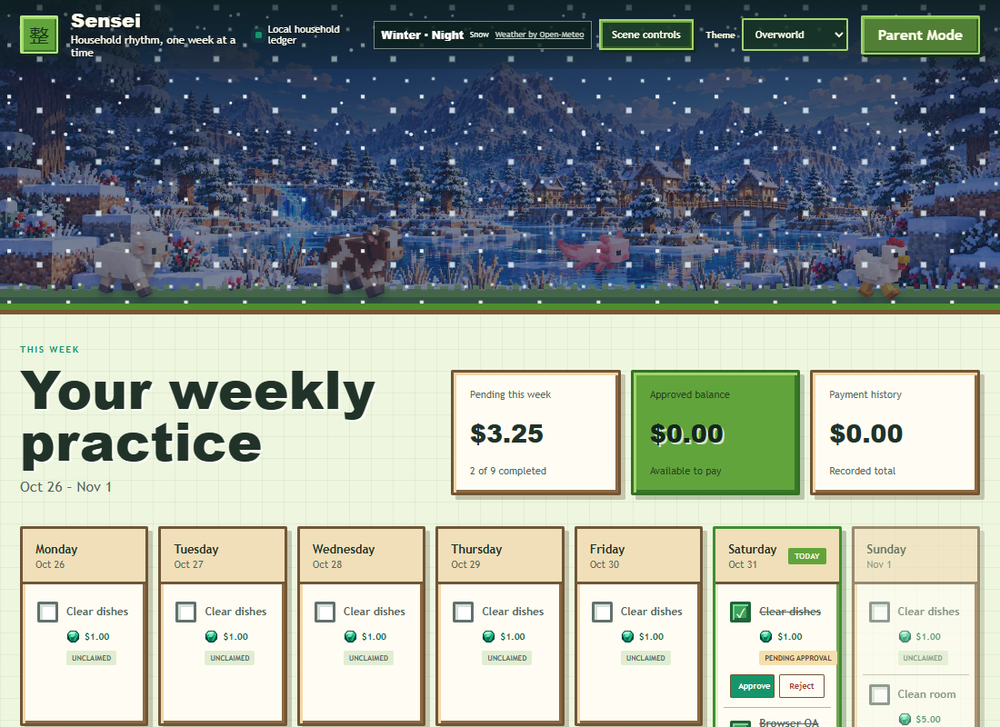

The mobile composition retains the scenic header, device theme control, allowance summary, checklist, calendar, and animal layers without horizontal overflow.

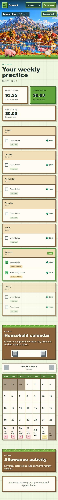

## Overworld artwork

The active v0.4 landscapes preserve the same mountain, village, bridge, and water landmarks through four seasons.

| Spring | Summer |
| --- | --- |
|  |  |
| Autumn | Winter |
|  |  |

Time of day is composed from reusable [morning](../public/assets/overworld-v04/lighting/morning.png), [day](../public/assets/overworld-v04/lighting/day.png), [evening](../public/assets/overworld-v04/lighting/evening.png), and [night](../public/assets/overworld-v04/lighting/night.png) overlays. Weather remains independent through six transparent overlays in `public/assets/overworld-v04/weather/`.

### Animal sheets

Each sheet contains eight normalized transparent frames: four movement frames and four idle/behavior frames.

| Sheep | Pig | Cow |
| --- | --- | --- |
| 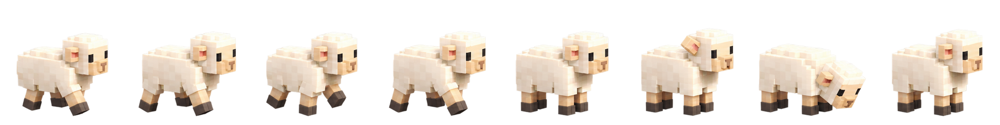 | 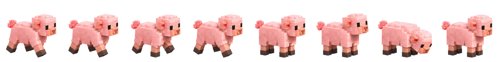 | 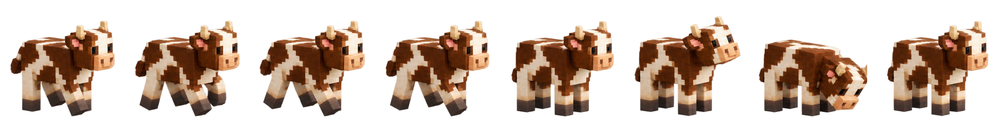 |
| Chicken | Axolotl | |
| 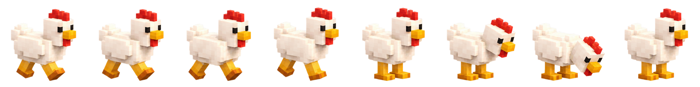 | 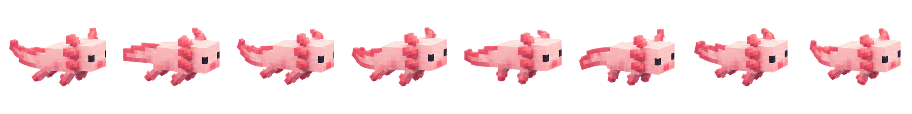 | |

The axolotl is rendered as an aquatic sprite in the water layer; land animals share a stable terrain baseline. Sprite stepping and wandering are CSS animations and stop when motion is disabled.

## Asset status

- `overworld-v04` is the active production set integrated into the application.
- `overworld` contains earlier production support art; its emerald asset remains part of the active chore/reward styling.
- High-resolution proof masters, reference boards, and isolated production previews are intentionally outside this application repository.
- No unfinished prototype is described here as implemented functionality.
- No general source or asset reuse license is granted by this checkpoint.
