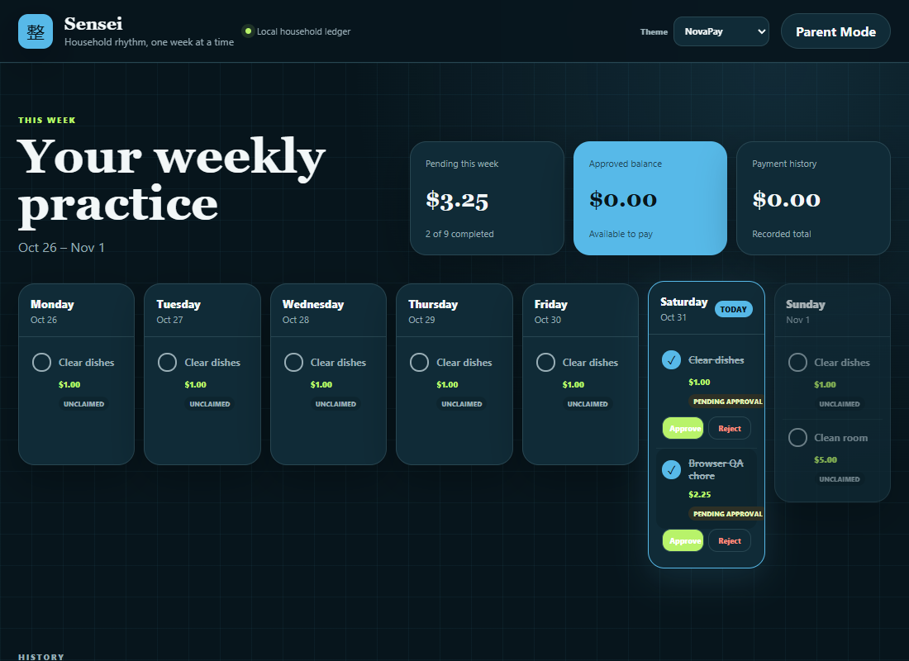
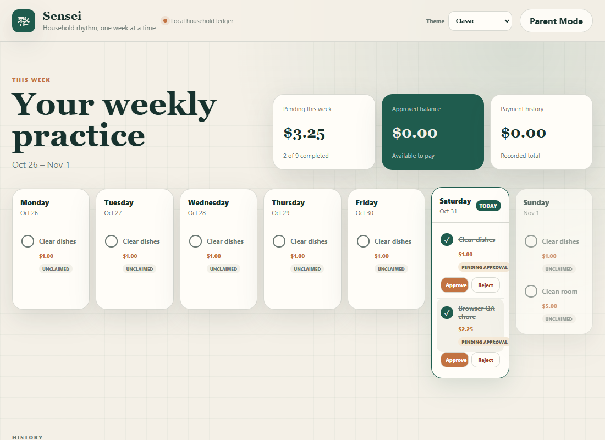
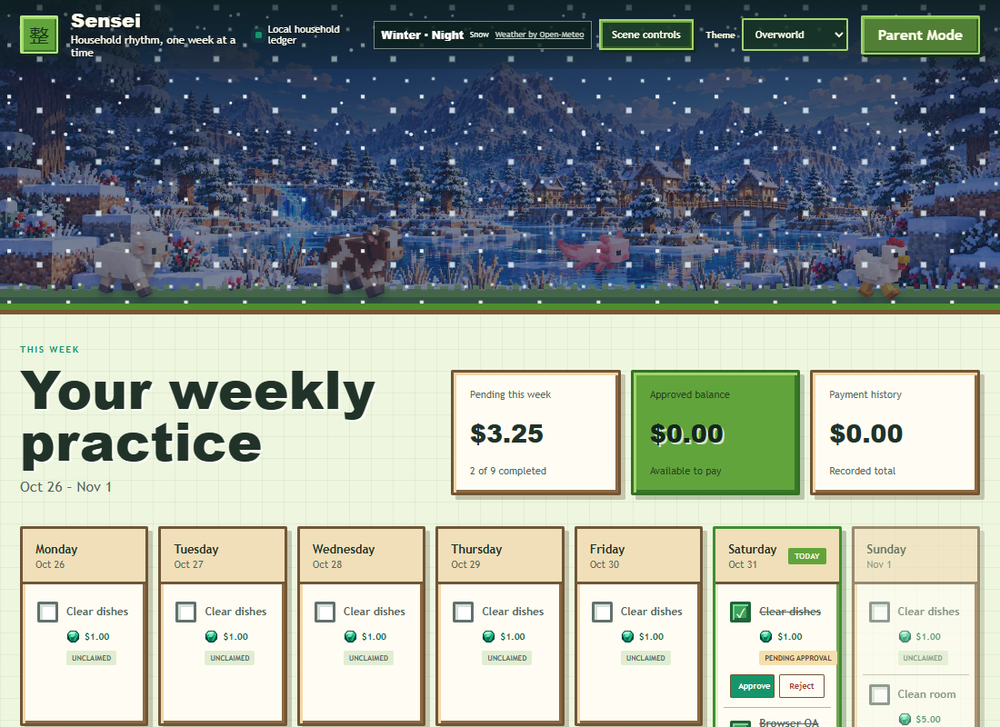

# Themes

Sensei has three production themes: NovaPay, Sensei Classic, and Overworld Adventure. Theme selection is available in the global header, requires no parent authorization, and is stored per device in `localStorage` under `sensei-device-theme`.

## Theme contract

`src/client/themes.ts` is the registry. Each `ThemeDefinition` supplies:

- a stable `id`, display `name`, and description;
- semantic colors for page, surfaces, text, brand, accent, borders, danger, and warnings;
- typography tokens;
- shape, shadow, and grid tokens.

`applyTheme()` writes those values as CSS custom properties on the document root and sets `data-theme`. Shared checklist, calendar, Parent Mode, and ledger components consume the semantic variables rather than branching on theme IDs.

Theme-specific CSS is limited to genuine visual differences. Overworld rules are scoped to `html[data-theme="minecraft"]`, and its scenic component is mounted only for that theme.

## Production themes

### NovaPay

The default theme uses deep slate surfaces, sky-blue controls, and lime approval accents. It emphasizes the financial dashboard while retaining high-contrast chore cards.

### Sensei Classic

Classic uses warm paper surfaces, evergreen text, clay accents, rounded cards, and restrained depth. It shares all functional components with NovaPay.

### Overworld Adventure

Overworld combines the token system with `OverworldScene.tsx` and theme-scoped CSS. Its active v0.4 system includes:

- four recognizable seasonal landscapes with a fourteen-day crossfade window around meteorological boundaries;
- morning, day, evening, and night lighting layers;
- clear, partly cloudy, cloudy, rain, snow, and fog overlays;
- a fixed approximate Seattle weather reference cached by the backend for 30 minutes;
- sheep, pig, cow, chicken, and aquatic axolotl sprite sheets;
- CSS sprite stepping and horizontal wandering without a game engine;
- a motion toggle, `prefers-reduced-motion`, and page-visibility pausing;
- responsive scene cropping and a compact header/control layout.

## Asset organization

| Path | Status |
| --- | --- |
| `public/assets/overworld-v04/landscapes/` | Active four-season production WebP landscapes |
| `public/assets/overworld-v04/lighting/` | Active transparent time-of-day overlays |
| `public/assets/overworld-v04/weather/` | Active transparent decorative weather overlays |
| `public/assets/overworld-v04/animals/` | Active eight-frame sprite sheets for five species |
| `public/assets/overworld-v04/terrain/` | Active foreground/detail layers |
| `public/assets/overworld/` | Earlier production support assets; emerald UI art remains in use |

The repository contains browser-ready derivatives, not the isolated high-resolution proof package or reference boards. The v0.4 files are production assets, not unfinished prototypes. See [the showcase](SHOWCASE.md) for representative artwork.

## Responsive and accessible behavior

Shared layouts collapse from multi-column desktop grids to single-column mobile cards. At narrow widths the header keeps Theme followed by Parent Mode on the far right. Overworld changes crop position, animal sizing, scene height, and its scene-control layout without changing application data or behavior.

Decorative layers use empty alternative text or are hidden from the accessibility tree. Keyboard focus remains visible. Reduced-motion removes continuous animal and weather animation while preserving scenery and status information.

## Adding another theme

A conventional theme needs only:

1. A new `ThemeDefinition` with every existing semantic token.
2. Visual checks at desktop and 390 px mobile widths.
3. Contrast, focus, calendar-state, and Parent Mode verification.
4. Optional CSS scoped to its `data-theme` value for genuinely unique treatment.

A theme that adds an environmental scene may follow the Overworld pattern: one isolated component, local assets, theme-scoped styles, and no feature-component forks. A generic plugin framework is unnecessary at the current scale.

## Attribution and reuse

The Overworld artwork is original Sensei-specific block-world material, not extracted Minecraft artwork. Decorative weather data is provided by [Open-Meteo](https://open-meteo.com/) and attributed in the application. No general artwork reuse license is declared by this checkpoint.
